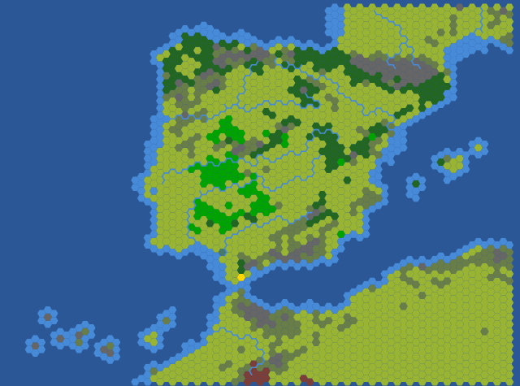

# Spainciv Unciv

[Español](#español) · [English](#english)

## Español

España como mapa de [Unciv](https://github.com/yairm210/Unciv), la versión libre de Civilization V, sacado del mapa
de [spainciv](https://spainciv.djinnfoundry.com): costa, relieve, ríos, cubierta del suelo y recursos de datos abiertos.

- 83 × 53 casillas de 25 km (1994 de tierra, 958 de ellas españolas).
- Reglas: Civ V - Gods & Kings, las de serie, más un recurso propio, el cerdo ibérico. Probado en Unciv 5.0.1.
- España empieza en Madrid; los demás jugadores, en 11 grandes áreas urbanas.
- Al elegir el mapa «España» en una partida nueva, Unciv activa este mod por sí solo.

| Recurso | Casillas | De dónde sale |
|---|---|---|
| Hierro | 35 | los yacimientos grandes y medianos de hierro del BDMIN del IGME y las explotaciones de óxidos de hierro de 2019 |
| Caballos | 19 | las comarcas agrarias con al menos 4 veces la densidad de équidos de España (Censo Agrario 2020, INE): 20 comarcas |
| Carbón | 13 | los yacimientos grandes y medianos de hulla, antracita, lignito y carbón del BDMIN (IGME), se exploten hoy o no |
| Petróleo | 2 | las concesiones de hidrocarburos en explotación (IGME, 2019); Unciv no tiene gas, así que cuentan como petróleo |
| Aluminio | 1 | los yacimientos grandes y medianos de bauxita del BDMIN (IGME); la casilla puede estar hasta a unos 50 km del yacimiento |
| Uranio | 3 | los yacimientos grandes y medianos de uranio del BDMIN (IGME); la casilla puede estar hasta a unos 50 km del yacimiento |
| Oro | 12 | los yacimientos grandes y medianos de oro del BDMIN (IGME) y la mina de oro activa en 2019 |
| Plata | 15 | los yacimientos grandes y medianos de plata del BDMIN (IGME) |
| Cobre | 28 | los yacimientos grandes y medianos de cobre del BDMIN (IGME) y las minas de cobre activas en 2019 |
| Mármol | 15 | las canteras de mármol (IGME, 2019) |
| Sal | 26 | las minas de sal gema, salinas marinas y de manantial (IGME, 2019) |
| Vino | 127 | las denominaciones de origen de vino (Ministerio de Agricultura) |
| Cerdo ibérico | 4 | las cuatro DOP de jamón ibérico: Jabugo, Guijuelo, Dehesa de Extremadura y Los Pedroches (recurso propio del mod) |
| Cítricos | 1 | las IGP Cítricos Valencianos y Clementinas de las Tierras del Ebro |
| Especias | 1 | las DOP Azafrán de La Mancha, Pimentón de la Vera y Pimentón de Murcia |
| Ganado | 5 | las IGP de carne de vacuno (Ternera Gallega, Ternera Asturiana, Carne de Ávila y otras) |
| Ovejas | 6 | las IGP de cordero (Cordero Manchego, Lechazo de Castilla y León, Ternasco de Aragón y otras) |
| Peces | 5 | las IGP y DOP de pescado y marisco (Mejillón de Galicia, Caballa de Andalucía, Mojama de Barbate y otras) |
| Piedra | 20 | las canteras de roca ornamental: granito, caliza, pizarra, arenisca y cuarcita (IGME, 2019) |

Cómo instalarlo y qué es dato real y qué es convención del juego: https://spainciv.djinnfoundry.com/jugar.html

## English

Spain as a map for [Unciv](https://github.com/yairm210/Unciv), the open-source Civilization V, built from the
[spainciv](https://spainciv.djinnfoundry.com) map: coast, relief, rivers, land cover and resources from open data.

- 83 × 53 tiles 25 km across (1994 land tiles, 958 of them Spanish).
- Ruleset: Civ V - Gods & Kings, the default, plus one resource of its own, the Iberian pig («Cerdo ibérico»). Tested
  in Unciv 5.0.1.
- Spain starts in Madrid; the other players in 11 large urban areas.
- When you pick the map «España» for a new game, Unciv turns this mod on by itself.

| Resource | Tiles | Source |
|---|---|---|
| Iron | 35 | IGME's BDMIN large and medium iron deposits and the iron-oxide workings of 2019 |
| Horses | 19 | the agricultural comarcas with at least 4 times Spain's density of equines (Censo Agrario 2020, INE): 20 comarcas |
| Coal | 13 | BDMIN (IGME) large and medium deposits of hard coal, anthracite, lignite and coal, worked today or not |
| Oil | 2 | the hydrocarbon concessions in production (IGME, 2019); Unciv has no gas, so gas fields count as oil |
| Aluminum | 1 | BDMIN (IGME) large and medium bauxite deposits; the tile may be up to about 50 km from the deposit |
| Uranium | 3 | BDMIN (IGME) large and medium uranium deposits; the tile may be up to about 50 km from the deposit |
| Gold Ore | 12 | BDMIN (IGME) large and medium gold deposits and the gold mine working in 2019 |
| Silver | 15 | BDMIN (IGME) large and medium silver deposits |
| Copper | 28 | BDMIN (IGME) large and medium copper deposits and the copper mines working in 2019 |
| Marble | 15 | marble quarries (IGME, 2019) |
| Salt | 26 | rock-salt mines, sea salt works and spring salt works (IGME, 2019) |
| Wine | 127 | the wine designations of origin (Ministry of Agriculture) |
| Cerdo ibérico (Iberian pig) | 4 | the four Iberian ham PDOs: Jabugo, Guijuelo, Dehesa de Extremadura and Los Pedroches (this mod's own resource) |
| Citrus | 1 | the PGIs Cítricos Valencianos and Clementinas de las Tierras del Ebro |
| Spices | 1 | the PDOs Azafrán de La Mancha (saffron), Pimentón de la Vera and Pimentón de Murcia (paprika) |
| Cattle | 5 | the beef PGIs (Ternera Gallega, Ternera Asturiana, Carne de Ávila and others) |
| Sheep | 6 | the lamb PGIs (Cordero Manchego, Lechazo de Castilla y León, Ternasco de Aragón and others) |
| Fish | 5 | the fish and shellfish PGIs and PDOs (Mejillón de Galicia, Caballa de Andalucía, Mojama de Barbate and others) |
| Stone | 20 | ornamental-rock quarries: granite, limestone, slate, sandstone and quartzite (IGME, 2019) |

How to install it, and what is real data and what is game convention (in Spanish): https://spainciv.djinnfoundry.com/jugar.html

Licence: CC BY 4.0 (see LICENSE).
